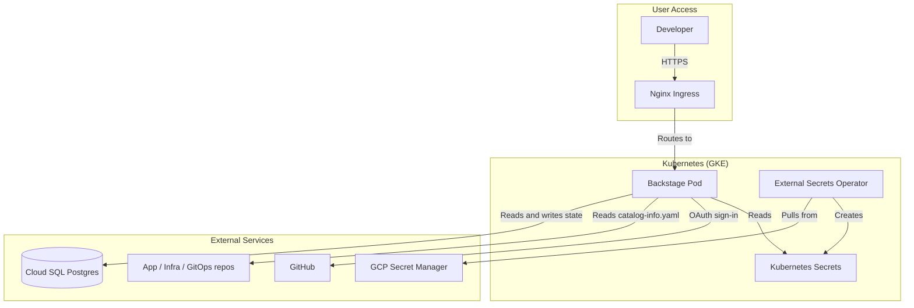
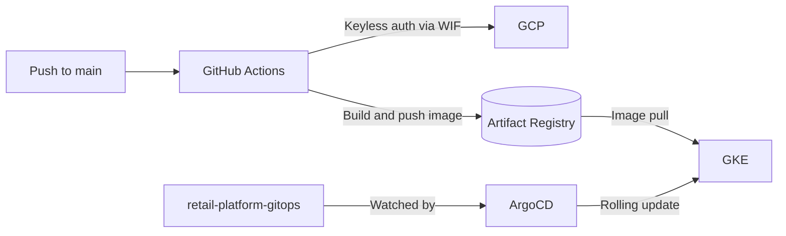

# Retail Platform: Backstage Developer Portal


This repository contains the source code for the **Retail Data Platform Internal Developer Platform (IDP)**, built on Spotify's [Backstage](https://backstage.io) framework. It is the single portal where developers discover services, see how the platform fits together, and find the owners and documentation for each component.

## Related Repositories

This platform uses a multi-repo architecture:

| Repository | Purpose |
|---|---|
| [RetailDataPlatform](https://github.com/benkivuva/RetailDataPlatform) | Application code (Python, dbt, Flask, Dagster) |
| [retail-platform-infrastructure](https://github.com/benkivuva/retail-platform-infrastructure) | Terraform for GCP infrastructure and cluster bootstrap |
| [retail-platform-gitops](https://github.com/benkivuva/retail-platform-gitops) | Kubernetes manifests reconciled by ArgoCD |
| **retail-platform-backstage** (this repo) | The developer portal (React frontend + Node.js backend) |

## Architecture

Backstage is a full-stack TypeScript application. It runs on GKE, is deployed by ArgoCD, and stores its state in a private Cloud SQL (Postgres) instance.

### Runtime



### Delivery



The image tag in the GitOps repo controls what runs in the cluster. This repo builds and publishes images; it does not deploy them directly.

## Key Features

- **Software Catalog:** Aggregates `catalog-info.yaml` files from the other repositories into a browsable map of the system.
- **GitHub authentication:** GitHub OAuth signs developers in and maps them to catalog `User` entities. Guest access is disabled.
- **New frontend system:** Uses Backstage's `app-next` architecture for a modular UI.
- **Zero-trust deployment:** Runs as a non-root container. Database credentials arrive through External Secrets Operator, never through files in Git.
- **Keyless CI/CD:** GitHub Actions authenticates to GCP with Workload Identity Federation, builds a multi-stage image, and pushes it to Artifact Registry.

## Repository Structure

```text
.
├── .github/workflows/            # CI pipeline: build and push the image
├── packages/
│   ├── app/                      # React frontend
│   └── backend/                  # Node.js backend and Dockerfile
├── app-config.yaml               # Base configuration (local development)
├── app-config.production.yaml    # Production overrides (DB, auth, catalog rules, CSP)
├── backstage.json                # Backstage version tracking
└── package.json                  # Root workspace configuration
```

## Prerequisites

- [Node.js](https://nodejs.org/) `v22` (manage with `fnm` or `nvm`)
- [Yarn](https://yarnpkg.com/) `v4`, enabled through Corepack: `corepack enable`
- A GitHub OAuth App (see [Authentication Setup](#authentication-setup))
- Access to the GCP Artifact Registry, only if you need to pull or push images manually

## Local Development

1. **Install dependencies**

   ```bash
   yarn install
   ```

2. **Provide GitHub OAuth credentials** (see the next section)

3. **Start the dev server**

   ```bash
   yarn dev
   ```

   The frontend is at `http://localhost:3000` and the backend at `http://localhost:7007`.

4. **Type-check before committing**

   ```bash
   yarn tsc
   ```

## Authentication Setup

Sign-in uses a GitHub OAuth App.

1. In GitHub, go to **Settings → Developer settings → OAuth Apps → New OAuth App**.
2. Set the callback URL to `<backend-base-url>/api/auth/github/handler/frame`
   - Local: `http://localhost:7007/api/auth/github/handler/frame`
   - Production: your `https://` portal URL, followed by the same path.
3. Create a separate OAuth App for each environment, because a GitHub OAuth App allows one callback URL.
4. Supply the client ID and secret as environment variables. In production they come from Secret Manager through External Secrets.

| Variable | Purpose |
|---|---|
| `GITHUB_CLIENT_ID` | GitHub OAuth App client ID |
| `GITHUB_CLIENT_SECRET` | GitHub OAuth App client secret |
| `POSTGRES_URL` | Cloud SQL connection (production only; injected from a Kubernetes Secret) |

> Variable names must match the `${...}` references in `app-config.yaml` and `app-config.production.yaml`. Adjust the table if your config uses different names.

## Registering Components in the Catalog

Each repository describes itself with a `catalog-info.yaml` at its root. Example:

```yaml
apiVersion: backstage.io/v1alpha1
kind: Component
metadata:
  name: retail-data-platform
  description: Flask BI platform, dbt models, and Dagster orchestration
  annotations:
    github.com/project-slug: benkivuva/RetailDataPlatform
spec:
  type: service
  lifecycle: production
  owner: group:default/data-platform-team
```

Backstage ingests these files from the repos configured under `catalog.locations`. Production catalog rules explicitly allow `User` and `Group` entities to be loaded from remote GitHub URLs; without that, sign-in cannot resolve a developer's identity.

## Production Build and Deployment

Backstage compiles native Node.js modules (for example `better-sqlite3` and `ssh2`). To keep builds consistent across machines, production images are built with a multi-stage Docker build in CI rather than on developer workstations.

### CI/CD pipeline

When changes are pushed to `main`, `.github/workflows/backstage_ci.yml`:

1. Authenticates to GCP through Workload Identity Federation (no stored keys).
2. Builds the image from `packages/backend/Dockerfile`.
3. Pushes it to Artifact Registry:
   `us-central1-docker.pkg.dev/<PROJECT_ID>/dev-retail-platform/backstage`

### Deployment (GitOps)

ArgoCD, configured in `retail-platform-gitops`, deploys the app. Those manifests define the Deployment, Service, Ingress, and ExternalSecrets. To release a new build, update the image tag in the GitOps repo; ArgoCD performs the rolling update.

### Building the image manually

```bash
docker build -f packages/backend/Dockerfile -t backstage:local .
```

Run this from the repository root so the build context includes the whole workspace.

## Configuration (`app-config.production.yaml`)

| Area | Behavior |
|---|---|
| **Database** | Connects to Cloud SQL using `POSTGRES_URL`, injected from a Kubernetes Secret |
| **Security (CSP)** | Content Security Policy allows connections over the custom `.nip.io` domain |
| **Authentication** | Guest access disabled; GitHub OAuth enforced |
| **Catalog rules** | `User` and `Group` entities may be ingested from remote GitHub URLs |

## Security

- Runs as a non-root container, consistent with the cluster's Kyverno policy.
- No credentials in Git or in the image; secrets flow from Secret Manager through External Secrets into the pod.
- CI uses Workload Identity Federation, so no service account keys exist.
- The database is private Cloud SQL, reachable only from inside the VPC.

## Troubleshooting

| Symptom | Likely cause |
|---|---|
| `Unknown auth provider 'github'` | `@backstage/plugin-auth-backend-module-github-provider` is missing from `packages/backend/src/index.ts` |
| `Failed to sign-in, unable to resolve user identity` | `catalog.rules` do not allow `User` entities, or no matching `User` entity exists in a `catalog-info.yaml` (for example in the GitOps repo) |
| `Invalid Redirect URI` | The GitHub OAuth App callback uses `http` instead of `https`, or the other way round |
| `OOMKilled` | The Node.js process exceeded the memory limit in the Kubernetes Deployment manifest |
| Catalog entities missing | The repository is not listed under `catalog.locations`, or its `catalog-info.yaml` is invalid |
| Pod rejected on creation | A Kyverno policy blocked it (for example, running as root) |

Useful commands:

```bash
kubectl get pods -n <namespace>
kubectl logs deploy/backstage -n <namespace>
kubectl get externalsecrets -n <namespace>
```

## Contributing

1. Branch from `main` and make your changes.
2. Run `yarn tsc` and fix any TypeScript errors.
3. Open a pull request and confirm the CI pipeline passes.
4. Merge after approval; GitHub Actions builds and pushes the new image.
5. Update the image tag in `retail-platform-gitops` to roll it out.